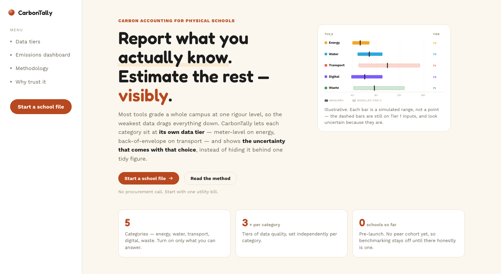
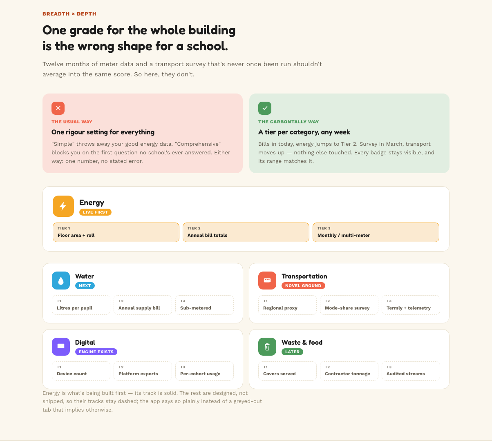
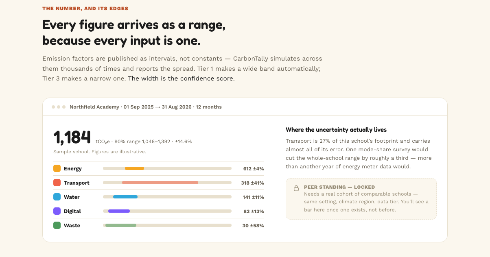
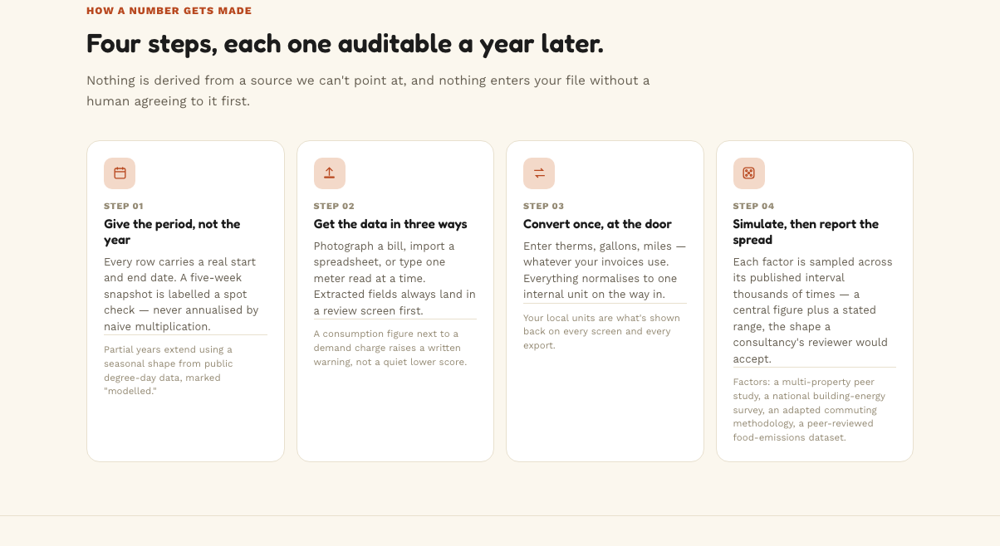
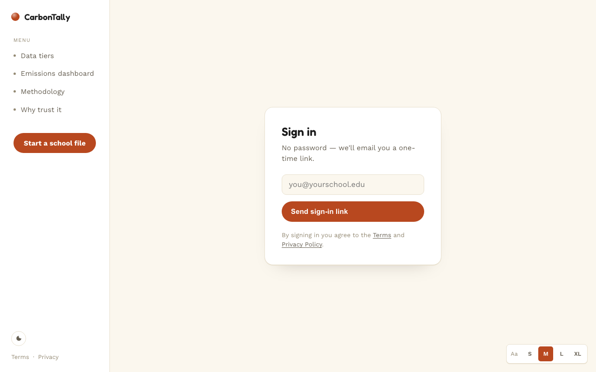

# CarbonTally


> [!NOTE]
> **Pre-launch, local-only.** CarbonTally is a multi-tenant rebuild of an earlier single-school
> calculator (see [The original calculator](#the-original-calculator)). There is no hosted site yet.
> Today it has a landing page, passwordless sign-in, a school profile, **one working module —
> Energy** — and a Dashboard and Reports view over what it saves. Of the nine items in the
> app's sidebar, four are real; the other five are tagged "Soon" and are designed, not built. The figures on the landing-page dashboard are illustrative.

Carbon-accounting tools tend to hand a whole school one score, so a campus with twelve months of
half-hourly meter data and no travel survey is judged as if both were equally well known.
**CarbonTally keeps them apart.** Each category — energy, water, transportation, digital, waste —
sits at **its own data tier**, and every figure comes back as a **range** whose width is the honest
measure of how well it is known, instead of one tidy number that hides the guesswork.

## Contents

[Screenshots](#screenshots) · [What works today](#what-works-today) · [Real examples](#real-examples) ·
[How a number gets made](#how-a-number-gets-made) · [Status and known gaps](#status-and-known-gaps) ·
[Tech stack](#tech-stack) · [Data model](#data-model) · [Running locally](#running-locally) ·
[The original calculator](#the-original-calculator) · [Privacy, terms, licence](#privacy-terms-licence)

## Screenshots

<p align="center"></p>

<p align="center"></p>

<p align="center"></p>

<p align="center"><sub>The dashboard above is a <b>sample school with illustrative figures</b> — Northfield Academy is fictional.</sub></p>

<p align="center"></p>

<p align="center"></p>

The signed-in pages (school profile, Energy, Dashboard, Reports) are not pictured: they need a real sign-in, and they have
not been screenshotted yet.

## What works today

- **Passwordless sign-in.** A one-time email link through Supabase Auth — no passwords stored. Every
  table is protected by row-level security, so a user only ever reaches the schools they belong to.
- **School profile with a confirm-before-save website look-up.** Paste a school's website; a server
  function reads its contact and location pages, an AI model extracts the name, email and campus
  addresses, and Mapbox places them. Everything arrives as *unconfirmed*, and each field records
  whether it was typed, detected, or detected and confirmed.
- **Energy module (Tier 2).** Register a meter, log a reading with explicit start and end dates, and
  get a Monte Carlo result — p10 / median / p90 tCO₂e — with a sourced derivation trace.
- **Dashboard and Reports.** The Dashboard shows the latest figure with its range, intensities per m²
  and per student, a tile per category, and concrete next steps (for example "the reading covers part
  of a year"). Reports lists every saved calculation with its emission factor, school size at the
  time, seed, and a step-by-step derivation. Both are read-only.
- **Reproducible, snapshotted reports.** A saved report stores its random seed, iteration count,
  factor version and the school-size figures it was computed against, so it can be regenerated and
  normalised later even if the school's profile changes.
- **A sourced emission-factor library.** Every factor carries its publisher, vintage, last-verified and
  review-due dates and its own uncertainty. A database function chooses the default — the most
  specific geographic match first (utility grid or country, then region, then global), and the newest
  vintage only to break ties *within* that level — instead of whichever source was cited first. The
  water, waste and fuel factors come from the UK Government's 2026 conversion-factor file, read by
  row ID rather than retyped. Where no factor exists for a school's own country, the UK one is offered
  only as a flagged **stand-in**, with the range deliberately widened to ±100%.
- **Light and dark themes, adjustable text size, and a mobile drawer menu.**

## Real examples

Outputs of the real engine (`runEnergySimulation`, and `runActivitySimulation` for the rest), seed 42, 10,000 iterations, for a fictional
8,000 m² school with 600 students. Same inputs and same seed always return the same result — a test
asserts it.

| Input | Result | What it shows |
|---|---|---|
| **1,109,200 kWh**, 1 Sep 2025 – 31 Aug 2026; UAE grid factor 0.3582 kgCO₂e/kWh (IEA 2025, ±10 %) | **397.1 tCO₂e** (p10 350.6 – p90 451.7) · 138.7 kWh/m² · 1,849 kWh/student · 49.6 kgCO₂e/m² | The headline case: a full year, a regional factor, consumption taken as metered |
| The same readings with the global factor 0.473 (Ember 2024, ±20 %) | **524.2 tCO₂e** (409.2 – 676.7) | The factor's source moves the answer by about a third and doubles the band — which is why the source is shown and switchable |
| **480,000 kWh**, 1 Sep 2025 – 31 Jan 2026 (5 months) | 171.9 tCO₂e (151.7 – 195.4), flagged **partial period** | Never multiplied up to a year; the intensities cover only the period measured |
| **700,000 kWh** Sep–Mar plus **400,000 kWh** May–Aug (April missing) | 393.8 tCO₂e (347.7 – 447.9) · 335 of 365 days covered · gap 1–30 Apr 2026 | A missing month is reported as a gap, not hidden by adding up period lengths |
| **36,100 m³** of water in a year, UK school: supply 0.1913 + treatment 0.17088 kgCO₂e/m³ (UK Government 2026, ±25 %) | **13.30 tCO₂e** (10.58 – 16.64) | Two factors price one reading; the band stays moderate because the factors are for this country |
| The same 36,100 m³ for a school **outside the UK**, same factors used as a stand-in | **15.25 tCO₂e** (6.83 – 33.75) | Same data, ±88 % band instead of ±23 %: the app refuses to look as certain as it did, and says why |
| **38 t** general waste to landfill + **9 t** food waste composted + **6 t** paper recycled | **19.85 tCO₂e** (13.72 – 29.03) | Each stream is priced by its own disposal route (520.58, 9.01 and 4.65 kgCO₂e/t) |
| The same school, but the 9 t of food waste goes to **landfill** (700.33 kgCO₂e/t) | **26.39 tCO₂e** (19.66 – 35.89) | The one decision moves the total by about a third |
| **18,000 L** diesel burned by school buses (2.66155 kgCO₂e/L, mineral diesel) | **47.90 tCO₂e** (45.00 – 51.08) | Fuel is chemistry, so the band is narrow (±6 %) |

## How a number gets made

These are the design choices in `web/src/lib/engine/`, each pinned by a test (67 engine tests; `npm test`
runs 205 in all, including the CSV importer, the bill-review logic, the Edge Function's privacy
behaviour, and two tests that stop the in-app legal text drifting from `docs/`):

- **At Tier 2 only the factor is uncertain.** A metered reading is a reading, not an estimate, so the
  band comes from the factor's published uncertainty. At Tier 1, consumption would itself be estimated
  and the band widens on its own — *the width is the confidence score*; there is no separate score to
  argue about.
- **Log-normal, not normal.** An emission factor is strictly positive, and a normal distribution at wide
  uncertainty samples negatives. It is parameterised so the distribution's *median* is exactly the
  published value. A test asserts no negative draw at 60 % uncertainty.
- **Coverage by merging intervals, not summing lengths.** Summing would inflate past 100 % on a re-issued
  overlapping bill and would hide gaps entirely, so eleven months with March missing would look the same
  as eleven consecutive months. Overlap raises a double-counting warning.
- **Partial periods are flagged, never annualised.** Doing that honestly needs a seasonal shape built
  from peer schools' data, which doesn't exist yet.
- **Seeded.** A small deterministic generator (mulberry32) means a stored report can be regenerated
  exactly.

## Status and known gaps

| Area | State |
|---|---|
| Landing page, sign-in, school profile, Energy, Dashboard, Reports | **Built.** The signed-in screens are the least battle-tested part: they have not had a full end-to-end walkthrough yet. |
| Self-service account deletion | **Written, not applied or tested.** `supabase/migrations/0012_delete_own_account.sql` and a test script are in the repo, and the Profile page has the button; the migration must be applied to a project first. |
| Digital, Benchmarking | **Not built** — tagged "Soon" in the sidebar, each opens an honest placeholder. Digital waits on emission factors that can be traced to a published number; the old calculator's parameters link to landing pages, not to figures. |
| Water, Waste, Transportation | **Built, needs migration 0013.** The factors and two small columns live in `supabase/migrations/0013_water_waste_fuel_factors.sql`; until it is applied to a project, these pages say so rather than guess. Transportation covers **school-run vehicles' fuel only** — pupil and staff commuting needs a survey that isn't built. Water and waste factors are UK-derived, and the waste ones cover collection, transport and landfill only (DESNZ says they "cannot be used to compare" disposal options). |
| CSV import | **Built and tested** on awkward files (semicolons, day-first dates, litres, duplicates, overlaps). Not yet used on a real utility export. |
| AI bill reading | **Written and tested, not deployed.** `supabase/functions/bill-extract` needs deploying to a project that has the `GEMINI_API_KEY` secret. The code around it is tested (what the model may be asked for, what is logged, how its answer is checked), but **no real bill has been read yet**, so its accuracy on real bills is unknown. |
| Peer benchmarking | **Deliberately off** until a real cohort of comparable schools exists. |
| Emission factors | Two example grid factors are seeded (UAE, IEA 2025; global, Ember 2024). The Ember figure was confirmed from secondary summaries because the primary page blocked automated fetching — its row says so. No utility-specific factor is included: its number could not be verified from a primary source, so none was invented. |

## Tech stack

**Frontend** — React 19, TypeScript, Vite, React Router, Mapbox GL JS, `marked` (renders the policies)
**Backend** — Supabase: Postgres with row-level security, Auth (magic link), two Edge Functions (Deno)
**AI** — Google Gemini, used for two things, both shown as drafts until you confirm: extracting a school's name, email and addresses from its public website, and reading the figures on an uploaded bill
**Integrations** — Mapbox geocoding, Google Fonts
**Quality** — Vitest (205 tests), oxlint, `tsc -b`
**Automation** — a scheduled GitHub Action (`supabase-keepalive.yml`) that queries the database every ~5 days, because free-tier Supabase projects pause after about a week of inactivity — which has already happened twice

## Data model

Nine tables in `public`, all with row-level security: `schools`, `school_members`, `school_contacts`,
`school_modules`, `meters`, `meter_log`, `reports`, `emission_factors`, `school_factor_choices`.
The schema lives entirely in [`supabase/migrations/`](supabase/migrations) (0001–0013) — nothing was
configured by hand in a dashboard, so it can be replayed onto a fresh project.

## Running locally

<details>
<summary><b>Setup commands</b> (click to expand)</summary>

You need Node and a Supabase project.

```bash
git clone https://github.com/AYDXB09/New-Carbon-Footprint-Dashboard-DG.git
cd New-Carbon-Footprint-Dashboard-DG/web
npm install
cp .env.example .env.local     # then fill in the three values
npm run dev                    # http://localhost:5173
npm test                       # 205 tests
npm run build                  # type-check + production build
```

**Supabase side**

1. Run the migrations in `supabase/migrations/` in order (`0001` → `0013`) in the SQL editor, or with the Supabase CLI. `0012` (account deletion) is optional — read its header first. `0013` adds the water, waste and fuel factors that those three modules need.
2. Authentication → URL Configuration: add `http://localhost:5173/**` to the allowed redirect URLs. Sign-in links redirect to `/profile`.
3. Deploy the Edge Functions and give them their secrets:
   ```bash
   supabase functions deploy school-lookup
   supabase functions deploy bill-extract        # optional: reading bills with AI
   supabase secrets set GEMINI_API_KEY=… MAPBOX_TOKEN=…
   ```
4. Free tier only: edit the project URL and key in `.github/workflows/supabase-keepalive.yml` to your own, or the project will pause when idle.

</details>

## The original calculator

Before the rebuild this repository was a single-page, client-side greenhouse-gas calculator for one
online school: upload a CSV of device hours, video-call sessions and learning-platform activity, run a
Monte Carlo simulation, export a PDF. Its files are still at the repository root — `index.html`,
`app.js`, `charts.js`, `styles.css` and `sample-data.csv` — kept as-is for reference and not part of
the new app. `landing.html` is a static mockup from an earlier visual direction.

## Privacy, terms, licence

[Privacy Policy](docs/PRIVACY.md) · [Terms of Service](docs/TERMS.md) · both are also served in the
app at `/privacy` and `/terms`. Released under the [MIT License](LICENSE).
